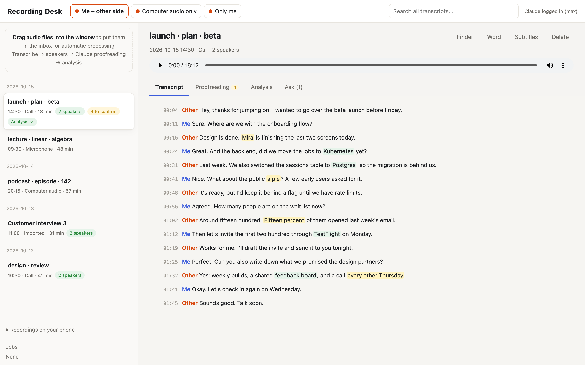
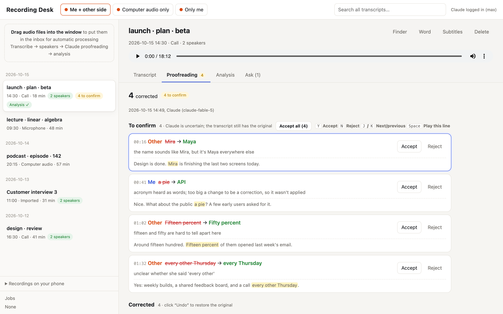

# Rex

**English** | [中文](README.zh-CN.md)

**Record calls, meetings and lectures on your Mac, and get a transcript that knows who said what.** Transcription runs on your machine with whisper.cpp. Optionally, Claude proofreads it as a list of corrections you approve, then writes an analysis you can ask follow-up questions about.



> macOS only (14.2+ for system audio), tested on macOS 26 with Apple Silicon · English and Chinese, following your macOS language · MIT · a personal tool in daily use, open-sourced as it is

## Highlights

- **Both sides of a call, on separate tracks.** `rex both` records your microphone and the computer's audio (Zoom, WeChat, FaceTime, a video in the browser) into one file with a track for each. The speaker labels in the transcript come from the tracks, not from a guess.
- **Nothing gets lost without a word.** No dropped samples, no silent recording when AirPods switch devices, no garbled track when a video call grabs the microphone mid-recording. A watchdog and live level meters per track tell you if something goes wrong.
- **Local transcription.** whisper.cpp (large-v3-turbo) with voice detection, and the language is detected per segment, so mixed Chinese and English comes out right. Recordings made on a single microphone can be split by voice.
- **Claude proofreads, you decide.** Claude returns only a list of corrections. Small fixes such as homophones are applied; anything bigger waits for you to accept or reject, one by one or all at once. Every change can be undone.
- **An analysis you can question.** Each recording gets a written analysis, and an Ask box continues the same session ("List the action items with owners").
- **The Recording Desk.** A local web UI that stays in the background: record, review corrections, search every transcript, export to Word or subtitles. Files dropped into the inbox folder are processed automatically, and you can record from your phone over Tailscale.



## Requirements

- macOS 14.2 or later for the system-audio tap. Older versions work with BlackHole only.
- [Homebrew](https://brew.sh): `brew install ffmpeg whisper-cpp blackhole-2ch`
  BlackHole is only needed for the fallback path; reboot once after installing it.
- Xcode Command Line Tools (`xcode-select --install`). `audiocap` and `audiodev` are compiled on first run.
- Python 3 (standard library only)
- Optional: [Claude Code](https://claude.com/claude-code) CLI for proofreading and analysis (`rex login`)

Downloaded on first use: the whisper model `large-v3-turbo-q5_0` (~547 MB, to `~/.cache/whisper`), and sherpa-onnx with its models (~93 MB, to `~/.cache/sherpa-onnx`) for `rex who`.

## Install

```bash
git clone https://github.com/hanbinyang707/rex.git
mkdir -p ~/.local/bin && ln -s "$PWD/rex/tools/rex.sh" ~/.local/bin/rex   # ~/.local/bin must be on your PATH
rex check       # microphone: first run asks for microphone permission
rex check sys   # system audio: asks for "System Audio Recording Only"; passes = rex uses the tap from now on
```

## Quick start

```bash
rex both      # record a call: you + the other side
rex stop      # stop; reports peak level and digital silence per track
rex go        # transcribe → speakers → proofread → analysis, for the latest recording
rex app       # open the Recording Desk (it then stays in the background and starts at login)
```

## Commands

| Command | What it does |
|---|---|
| `rex` | Toggle microphone recording (bind it to a hotkey) |
| `rex both` | Microphone + system audio, one file with separate tracks. **Use this for calls.** |
| `rex sys` | System audio only (podcasts, videos) |
| `rex stop` / `rex status` | Stop; check that every track is actually receiving audio |
| `rex text [file]` | Transcribe locally (whisper.cpp, VAD, segments by language) |
| `rex who [file] [n]` | Speaker diarization (sherpa-onnx) for single-track multi-person recordings |
| `rex go [file]` | Transcribe → speakers → Claude proofreading → Claude analysis |
| `rex auto install` | Watch `~/Recordings/收件箱` (inbox) with launchd; anything dropped there goes through `rex go` |
| `rex app` | Recording Desk web UI at `http://127.0.0.1:8790`, running in the background and starting at login: record, review corrections (Y/N, or accept all at once), ask follow-up questions, search, double-click a recording to move it to the Trash |
| `rex link` | **Record from your phone**: prints a QR code; open it in the phone's browser and record. Audio streams back to the Mac and goes through `rex go` (over Tailscale, so only your own devices can reach it) |
| `rex export [file] [docx\|srt]` | Export a transcript as Word, or get its subtitle file; the Recording Desk and the phone page have the same two buttons |
| `rex join rec1 rec2 …` | **Join one event recorded in parts** into a single recording: one transcript, one analysis. Existing transcripts are reused; the originals move to `已合并/`. In the Recording Desk, ⌘-click several, or drop several files in together |
| `rex phone` | Import iPhone Voice Memos synced through iCloud |
| `rex url <link>` | Download a podcast episode's audio and transcribe it |
| `rex find <word>` | Search all transcripts |
| `rex trim [file]` | Cut trailing silence (the original goes to the Trash) |
| `rex check` / `rex check sys` | 3-second self-tests; they also trigger the permission prompts |

Run `rex help` for every option. Full manual: [English](docs/manual.md) · [中文](docs/manual.zh-CN.md).

## Why it exists

Every design decision here comes from a recording that failed without any error message:

- **ffmpeg's avfoundation input drops ~14% of samples.** The file plays normally, but it is missing about a seventh of the audio. rex reads devices directly through CoreAudio with a small Swift helper, `audiocap`. ffmpeg only encodes.
- **AirPods automatic switching takes over the output device mid-call.** When you record system audio through a BlackHole multi-output device and the output changes, BlackHole records silence. rex captures system audio with a **Core Audio process tap** (macOS 14.2+), which never touches the output device. If the tap isn't available, it falls back to BlackHole and switches the output back within 2 seconds.
- **The tap delivers nothing while no app is playing audio.** It doesn't record silence; it delivers no frames at all. `audiocap` writes inaudible silence to the built-in speaker so the tap keeps running.
- **Video calls change the microphone mid-recording.** When WeChat or FaceTime opens the built-in microphone for echo cancellation, macOS switches it from 1 to 3 channels (and back when the call ends), and both tracks pause for a moment each time. rex keeps the channel count it started with and fills each pause with the same length of silence, so the tracks stay aligned.
- **Permission prompts never appeared.** macOS assigns a command-line tool's privacy permissions to the terminal that launched it. A terminal that doesn't declare system audio capture as a purpose gets no prompt, only zeros. `audiocap` relaunches itself as its own "responsible process" with an embedded Info.plist, so the grants belong to "rex 录音采集".
- **"Who said this" is recorded, not guessed.** `rex both` stores the mixed audio plus a separate microphone track and system-audio track in one file. The transcript labels come from the tracks, not from a model.
- **whisper detects the language only once per file.** Chinese/English mixed recordings come out garbled. rex checks the language at several points through the file and transcribes each segment in its own language.
- **Failures are reported.** A watchdog, live level meters per track, digital-silence detection and notifications tell you when something is wrong. If a recording stops on its own, rex finishes the file and tells you.

## Permissions

- Microphone and system-audio permissions belong to **"rex 录音采集"** (the `audiocap` helper, kept in `~/.local/share/rex/bin`), not to your terminal. They work the same whether rex is started from any terminal, the web UI or launchd.
- `audiocap` is ad-hoc signed. **Rebuilding it (any change to `audiocap.swift` or `audiocap-Info.plist`) changes its signature, so macOS asks again.** rex warns you when it rebuilds.
- It uses private APIs: `responsibility_spawnattrs_setdisclaim`, and `TCCAccessPreflight` / `TCCAccessRequest` from TCC.framework. They may break in a future macOS. If the tap stops working, rex falls back to BlackHole for that recording.
- `rex phone` needs Full Disk Access for the terminal you run it from.

## Privacy

- Recording, transcription and speaker diarization all run on your Mac.
- Only `rex go` and the web UI's "ask" box send text out: the transcript goes to Anthropic through your local `claude` login. rex clears `ANTHROPIC_*` environment variables first, so a shell that points `claude` at another provider doesn't redirect your transcripts. Set `REX_CLAUDE_ENV=inherit` to keep them.
- The web UI listens on `127.0.0.1` only and checks the Host header, a per-launch cookie token and the request origin.
- The phone service behind `rex link` is a separate process, also bound to `127.0.0.1`, reachable only from your own tailnet through `tailscale serve` (not Funnel, never the public internet).
  It can only receive recordings and files, list recent transcripts and download them; it cannot delete, edit, start a recording or send anything to Claude. The token is in the QR code; `rex link new-token` replaces it.
- **Recording other people:** consent laws differ (one-party vs. all-party). Tell people you are recording.

## Language

rex speaks English and Chinese: command output, `rex help`, notifications, the Recording Desk web UI, report headings and the prompts it sends to Claude (so proofreading notes and analyses come back in your language). It follows your macOS language: Chinese → Chinese, anything else → English. Override it with `REX_LANG=en` or `REX_LANG=zh`, or put `en` or `zh` in `~/.config/rex/lang`.

A few names stay the same in both languages because they are file formats: the inbox folder `~/Recordings/收件箱`, and the report files `.校对.md` (proofreading) and `.分析.md` (analysis). Code comments are in Chinese. The manual is in [English](docs/manual.md) and [中文](docs/manual.zh-CN.md).

## Layout

| Path | What |
|---|---|
| `tools/rex.sh` | The `rex` command (bash 3.2) |
| `tools/audiocap.swift` | CoreAudio capture → named pipe → ffmpeg; system-audio tap; permission handling |
| `tools/audiodev.swift` | List/switch audio devices, build the BlackHole multi-output device |
| `tools/whisper_run.py`, `tools/whisper_gaps.py` | Language probing, segmenting, whisper-cli; afterwards, finding stretches with speech but no text and re-transcribing them |
| `tools/speakers.py`, `tools/diarize.py` | Two-track dialogue merge (echo removal); voiceprint diarization |
| `tools/proofread.py`, `tools/analyze.py`, `tools/claude_cli.py` | Claude proofreading (only a list of corrections, applied verbatim) and analysis |
| `tools/rex_app.py`, `tools/rex_app/` | Recording Desk web UI |
| `tools/rex_link.py`, `tools/rex_link/` | Phone recording service and page (`rex link`) |
| `tools/rex_export.py` | Word / subtitle export |
| `tools/rex_join.py` | Join recordings of one event into one |
| `tools/whisper-prompt.txt`, `tools/whisper-fix.txt` | Templates for your vocabulary hints and fixed replacements; copy them to `~/.config/rex/` and edit there |
| `docs/manual.md`, `docs/manual.zh-CN.md` | Full manual (English, Chinese) |

Your recordings and transcripts stay in `~/Recordings`, never in this repo. The screenshots above use made-up demo recordings.

## Development

```bash
python3 -m unittest discover -s tests
bash -n tools/rex.sh
```

Code comments explain *why* (in Chinese). Most describe a real failure and how it was found. Read them before changing a threshold.

## License

[MIT](LICENSE). Nothing below is bundled; it is installed separately or downloaded on first use: whisper.cpp (MIT), sherpa-onnx (Apache-2.0), pyannote segmentation-3.0 (MIT), 3D-Speaker CAM++ (Apache-2.0), BlackHole (GPL-3.0), ffmpeg (LGPL/GPL).
