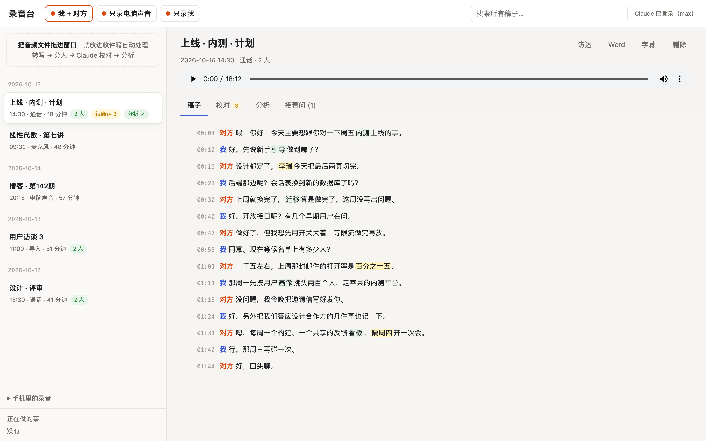
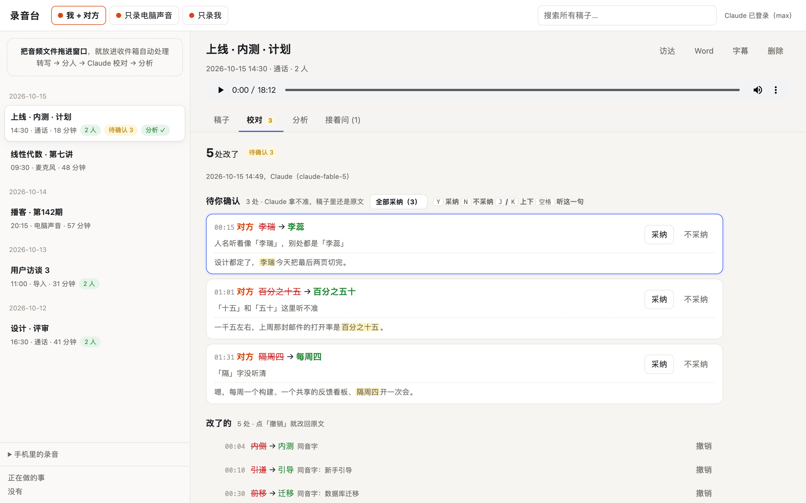

# Rex

[English](README.md) | **中文**

**在 Mac 上录通话、会议、讲座，拿到一份知道「谁说了什么」的稿子。** 转写全在本机（whisper.cpp）。
可以再让 Claude 校对：它只交一份修改清单，由你拍板；然后写一份能接着问的分析。



> 只支持 macOS（录电脑声音要 14.2 以上），在 macOS 26 + Apple Silicon 上测过 · 中英文界面，跟着系统语言走 · MIT · 个人日常在用的工具，原样开源

## 亮点

- **通话两边分轨录**：`rex both` 把你的麦克风和电脑放出来的声音（腾讯会议、微信、FaceTime、网页里的视频都行）
  存进一个文件、各占一条轨。稿子里的「我」「对方」是录出来的，不是猜的。
- **不会悄悄丢东西**：不丢采样；AirPods 自动切换设备也不会录成静音；视频通话中途抢麦克风，也不会把那一路录乱。
  看门狗和每一路的实时电平条，出了问题当场告诉你。
- **本地转写**：whisper.cpp（large-v3-turbo）加人声检测，按段识别语言，中英混说也转得对；
  一个麦克风录的多人谈话能按声纹分人。
- **Claude 校对，你来拍板**：Claude 只交一份修改清单。同音字这类小错直接改；改动大的留给你，
  逐条「采纳 / 不采纳」或者一键全部采纳，每一处都能撤销。
- **能接着问的分析**：每条录音一份分析报告，「接着问」接着同一个会话聊（「把待办按负责人列一下」）。
- **录音台**：常驻后台的本地网页：录音、确认校对、搜所有稿子、导出 Word / 字幕。往收件箱文件夹丢文件就自动处理；
  还能经 Tailscale 用手机录。



## 需要什么

- macOS 14.2 以上（系统音频接口）；更早的系统只能走 BlackHole
- [Homebrew](https://brew.sh)：`brew install ffmpeg whisper-cpp blackhole-2ch`
  （BlackHole 只给退路用，装完重启一次）
- Xcode 命令行工具（`xcode-select --install`）：第一次运行时编译 `audiocap` 和 `audiodev`
- Python 3（只用标准库）
- 可选：[Claude Code](https://claude.com/claude-code) 命令行，校对和分析用（`rex login` 登录）

第一次用时自动下载：whisper 模型 `large-v3-turbo-q5_0`（约 547 MB，放 `~/.cache/whisper`）；`rex who` 用的
sherpa-onnx 和模型（约 93 MB，放 `~/.cache/sherpa-onnx`）。

## 安装

```bash
git clone https://github.com/hanbinyang707/rex.git
mkdir -p ~/.local/bin && ln -s "$PWD/rex/tools/rex.sh" ~/.local/bin/rex   # ~/.local/bin 要在 PATH 里
rex check       # 麦克风：第一次会弹麦克风授权框
rex check sys   # 电脑声音：弹「仅系统录音」授权框；通过后录电脑声音就走系统音频接口
```

## 上手

```bash
rex both      # 录一通电话：你 + 对方
rex stop      # 停；报告每一路的峰值和数字静音
rex go        # 最近一条：转写 → 分人 → 校对 → 分析
rex app       # 打开录音台（之后常驻后台、开机自动起）
```

## 功能

| 命令 | 做什么 |
|---|---|
| `rex` | 开关麦克风录音（适合绑快捷键） |
| `rex both` | 麦克风 + 电脑声音，一个文件、分轨存。**打电话用这个** |
| `rex sys` | 只录电脑声音（播客、视频） |
| `rex stop` / `rex status` | 停；看每一路是不是真的有声音进来 |
| `rex text [文件]` | 本地转写（whisper.cpp，人声检测，按语言分段） |
| `rex who [文件] [人数]` | 声纹分人（sherpa-onnx），给一个麦克风录的多人谈话用 |
| `rex go [文件]` | 一条龙：转写 → 分人 → Claude 校对 → Claude 分析 |
| `rex auto install` | launchd 盯着 `~/Recordings/收件箱`，丢进去的录音自动走 `rex go` |
| `rex app` | 录音台网页界面 `http://127.0.0.1:8790`，常驻后台、开机自动起：录音、确认校对（逐条 Y/N，或一键全部采纳）、接着问、搜索、双击一条移到废纸篓 |
| `rex link` | **用手机录**：打一个二维码，手机浏览器扫开就能录，边录边传回 Mac、自动走 `rex go`（经 Tailscale，只有你自己的设备连得上） |
| `rex export [文件] [docx\|srt]` | 把稿子导出成 Word，或拿到字幕文件；录音台和手机页上也有这两个按钮 |
| `rex phone` | 取 iCloud 同步过来的 iPhone 语音备忘录 |
| `rex url <链接>` | 下载播客单集音频并转写 |
| `rex find <词>` | 搜所有稿子 |
| `rex trim [文件]` | 切掉末尾的空白（原件进废纸篓） |
| `rex check` / `rex check sys` | 3 秒自检，顺带触发授权框 |

全部选项见 `rex help`，完整手册见 [docs/manual.zh-CN.md](docs/manual.zh-CN.md)（英文版 [docs/manual.md](docs/manual.md)）。

## 为什么要做它

这里的每个设计都对应一次**不报错的失败**：

- **ffmpeg 的 avfoundation 输入会悄悄丢掉约 14% 的采样**：文件能放、听着正常，少了七分之一。rex 用一个
  Swift 小工具 `audiocap` 直接从 CoreAudio 读设备，ffmpeg 只管编码。
- **AirPods 的「自动切换」会在通话中途抢走输出设备**：靠 BlackHole 多输出设备录电脑声音时，输出一被改走
  就录成了静音。rex 改用 **Core Audio 系统音频接口**（macOS 14.2 起的 process tap）录，完全不碰输出设备；
  用不了时退回 BlackHole，输出被切走两秒内接回。
- **系统音频接口在没有程序放声音时一帧都不给**（不是静音，是什么都没有）。`audiocap` 往内建扬声器写听不见的
  静音，让它一直转。
- **视频通话会中途改掉麦克风的格式**：微信、FaceTime 打开内置麦克风做回声消除时，macOS 会把它从 1 声道切成
  3 声道（挂断再切回来），每切一次两路都会停顿一下。rex 照旧按开录时的声道数录，用同样长的静音补上停顿，两路照样对齐。
- **授权框根本弹不出来**：macOS 把命令行程序的隐私授权算在起它的终端头上，终端没申报「录系统声音」这项
  用途，就不弹框、只给全零。`audiocap` 带着内嵌的 Info.plist、以自己的名义重新启动，授权记在「rex 录音采集」头上。
- **「谁在说话」录的时候就知道，不靠猜**：`rex both` 一个文件里存混音，外加麦克风、系统声音各一条轨，
  对话稿的标签来自分轨，不是模型猜的。
- **whisper 一个文件只认一次语言**：中英混说的录音会被硬解成一种。rex 沿着文件探测语言、分段各转各的。
- **降级必须看得见**：看门狗、每一路的实时电平、数字静音检测、系统通知。录音自己停了会自动收好尾并告诉你。

## 权限

- 麦克风和系统声音的授权记在 **「rex 录音采集」**（`audiocap`，放在 `~/.local/share/rex/bin`）头上，不是终端：
  从哪个终端、录音台、launchd 起都一样。
- `audiocap` 是 ad-hoc 签名的。**重新编译一次（改了 `audiocap.swift` 或 `audiocap-Info.plist`）签名就变了，
  系统会再问一次授权。** rex 重编时会提醒。
- 用了私有接口：`responsibility_spawnattrs_setdisclaim`，以及 TCC.framework 的 `TCCAccessPreflight` /
  `TCCAccessRequest`。将来的 macOS 可能会改；系统音频接口用不了时，那一次录音会自动退回 BlackHole。
- `rex phone` 要给你跑命令的终端「完整磁盘访问权限」。

## 隐私

- 录音、转写、分人全在本机。
- 只有 `rex go` 和录音台的「接着问」会把稿子发出去：经你本机 `claude` 命令行的登录发给 Anthropic。rex 会先
  清掉 `ANTHROPIC_*` 环境变量，免得终端里把 `claude` 指到了别家接口、稿子被发到那边。想沿用：`REX_CLAUDE_ENV=inherit`。
- 录音台只监听 `127.0.0.1`，核对 Host 头、每次启动换的 cookie 口令和请求来源。
- `rex link` 的手机服务是另一个进程，也只听 `127.0.0.1`，经 `tailscale serve` 只对你自己的 tailnet 开放（不用 Funnel，不上公网）。
  它只能收录音、收文件、列最近的稿子、下载稿子；不能删、不能改、不能开录、不能发给 Claude。口令在二维码里，`rex link new-token` 换掉。
- **录别人之前先说一声**：各地法律不同（一方同意 / 各方同意）。

## 语言

命令输出、`rex help`、通知、录音台网页、报告标题、发给 Claude 的提示词（校对理由和分析也就用同一种语言回来）都有中英两套，默认跟 macOS 的首选语言：中文就中文，其余是英文。想固定一种：`REX_LANG=zh` / `REX_LANG=en`，或者往 `~/.config/rex/lang` 里写 `zh` / `en`。

有几个名字两种语言下都不变，因为它们是文件格式：收件箱文件夹 `~/Recordings/收件箱`，报告文件 `.校对.md`、`.分析.md`。代码注释是中文。

## 目录

| 路径 | 是什么 |
|---|---|
| `tools/rex.sh` | `rex` 命令本体（bash 3.2） |
| `tools/audiocap.swift` | CoreAudio 采集 → 命名管道 → ffmpeg；系统音频接口；授权 |
| `tools/audiodev.swift` | 查 / 切音频设备，建 BlackHole 多输出设备 |
| `tools/whisper_run.py` | 探测语言、分段、调 whisper-cli |
| `tools/speakers.py`、`tools/diarize.py` | 两轨合成对话稿（去回声）；声纹分人 |
| `tools/proofread.py`、`tools/analyze.py`、`tools/claude_cli.py` | Claude 校对（只收修改清单、逐字替换）和分析 |
| `tools/rex_app.py`、`tools/rex_app/` | 录音台网页界面 |
| `tools/rex_link.py`、`tools/rex_link/` | 用手机录（`rex link`）的服务和页面 |
| `tools/rex_export.py` | 导出 Word / 字幕 |
| `tools/whisper-prompt.txt`、`tools/whisper-fix.txt` | 词表和确定性替换的模板：拷到 `~/.config/rex/` 下再改 |
| `docs/manual.zh-CN.md`、`docs/manual.md` | 完整手册（中文、英文） |

录音和稿子放在 `~/Recordings`，不进这个仓库。上面的截图用的是编出来的演示录音。

## 开发

```bash
python3 -m unittest discover -s tests
bash -n tools/rex.sh
```

代码注释写的是「为什么」，大多对应一次真实的故障和它是怎么被发现的。改阈值之前先读注释。

## 许可

[MIT](LICENSE)。下面这些都不随仓库分发，由你另外安装或第一次使用时下载：whisper.cpp（MIT）、sherpa-onnx
（Apache-2.0）、pyannote segmentation-3.0（MIT）、3D-Speaker CAM++（Apache-2.0）、BlackHole（GPL-3.0）、ffmpeg（LGPL/GPL）。
